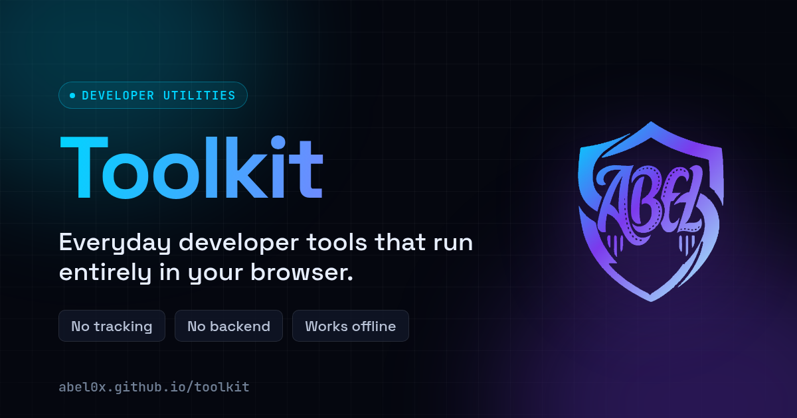
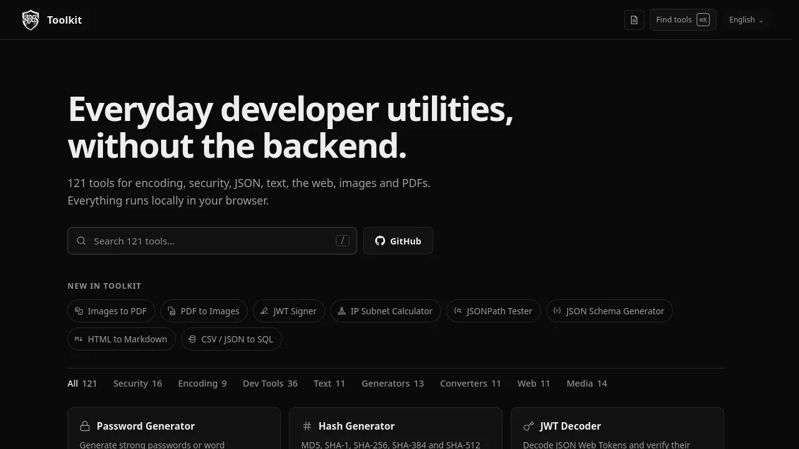
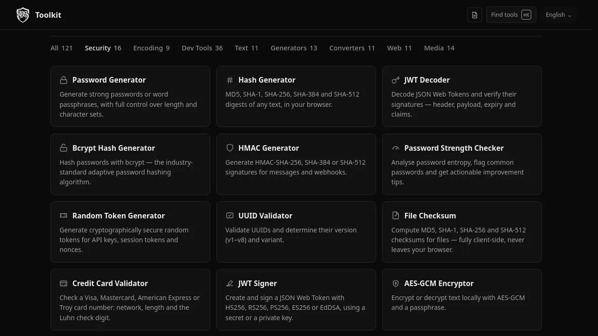
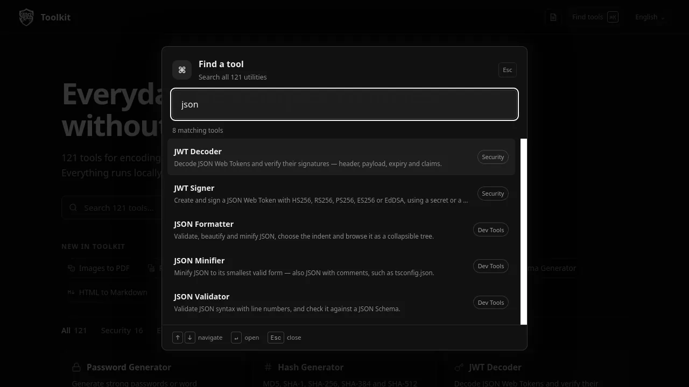
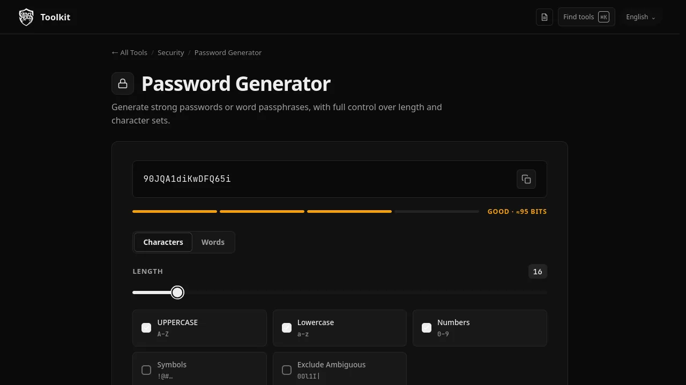
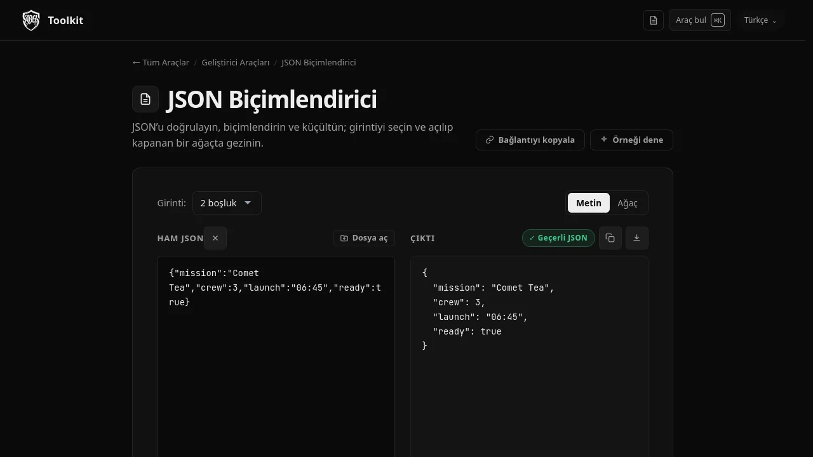
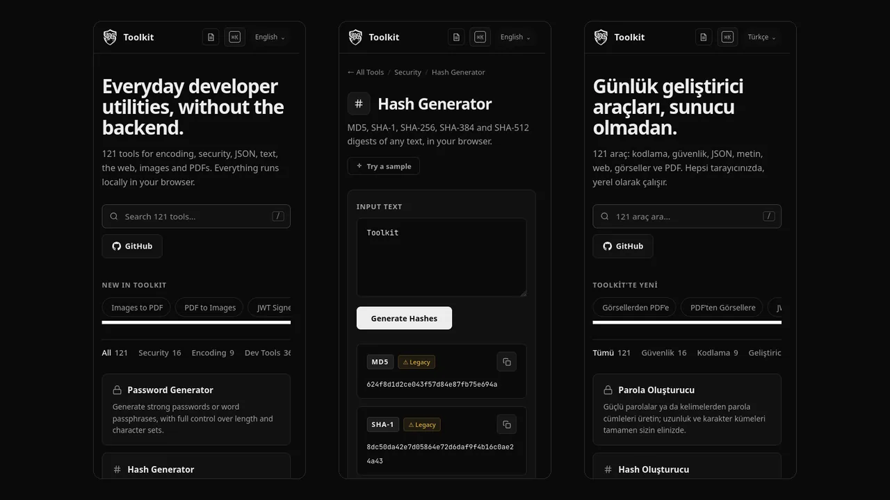

<div align="center">


# Toolkit

### 101 developer utilities that run entirely in your browser.

[](https://abel0x.github.io/toolkit/)
[](https://abel0x.github.io/toolkit/#tools-hub)
[](LICENSE)
[](#privacy-and-offline)

**[Open Toolkit](https://abel0x.github.io/toolkit/)** · [Türkçe](https://abel0x.github.io/toolkit/tr/) · [Contributing](CONTRIBUTING.md) · [Security](SECURITY.md)



</div>

---

## What it is

Toolkit is a static collection of developer utilities for the everyday work that should not require uploading data to a third party: encoding, cryptography, data conversion, text work, web inspection, image handling, and more.

- Tool input stays on your device. It is processed with browser APIs such as Web Crypto, FileReader, Canvas, and `Intl`.
- After the first successful load the service worker has cached the site, so the tools keep working without a network connection.
- <kbd>Ctrl</kbd>/<kbd>Cmd</kbd> + <kbd>K</kbd> searches the whole catalogue from any page, and <kbd>Ctrl</kbd>/<kbd>Cmd</kbd> + <kbd>Enter</kbd> in a tool's field runs the tool. <kbd>?</kbd> lists the shortcuts a page answers to.
- The interface is in English and Turkish. Every page also has a Turkish address under `/tr/` (for example `/toolkit/tr/tools/base64.html`) with Turkish titles and descriptions for search engines. The language menu switches between the two, and the choice is remembered in that browser: a visitor who chose Turkish and opens an English address is sent to its Turkish page. English pages do not download the Turkish dictionaries.
- There are no accounts, no backend, no analytics, and no stored tool input.

> A small amount of interface state is stored locally: the selected language, the recently opened tools, and Typing Speed Test preferences (personal bests only if you opt in). The [privacy page](https://abel0x.github.io/toolkit/privacy/) lists every item by name; tool input, typed text, generated results, and opened files are never persisted.

## Tool catalogue

The [live site](https://abel0x.github.io/toolkit/) is the complete, searchable catalogue of all 101 tools. The current distribution is:

| Area | Tools | Examples |
| --- | ---: | --- |
| Security | 14 | Passwords, SHA/HMAC, AES-GCM, RSA, TOTP, certificates |
| Encoding | 9 | Base64, Base32, URL, HTML, Hex, Binary |
| Dev Tools | 28 | JSON, CSV, XML, regex, cron, CSS, HTTP, WCAG contrast |
| Text Tools | 11 | Word count, typing speed, diff, Unicode, slug, find and replace |
| Generators | 9 | UUID, QR, gradients, colours, fake data |
| Converters | 10 | Timestamp, time zone, date duration, units, bytes |
| Web Utilities | 11 | URL, meta tags, CSP, cURL, HTTP headers, sitemap |
| Media | 9 | Image metadata, compression, SVG, QR reader, favicon |

### Latest release — 1.8.2

Every tool is named and described in one place now, so the home page, the tool finder, the page itself and search results say the same thing, and no description promises a feature the tool does not have. Twelve tools that had two or three names now have one.

### 1.8.1

Seventeen tools fixed after a review of every tool: the SQL Formatter keeps strings and comments intact, YAML to JSON reads real files (flow lists, multi-line text, anchors), the CSS, JavaScript and HTML minifiers minify whole files, CSV to JSON reads semicolon CSV, the Text Sorter and Case Converter follow Turkish letter rules, the Password Strength checker spots common words with a year or symbols added, and the Color Converter reads any CSS colour with alpha.

### 1.8.0

Text Diff can ignore whitespace and case, shows a side-by-side view with line numbers, and marks the changed words. The JSON Formatter lets you choose the indent and browse the result as a collapsible tree, the Regex Tester replaces matches with groups such as `$1`, and the Markdown Previewer downloads your document as an HTML page. Every page now passes an automated accessibility audit (axe-core, WCAG 2.2 AA), which led to clearer contrast, a keyboard-friendly QR drop zone and better button names, and the Markdown editor sits beside its preview again.

Earlier releases are described in the [changelog](CHANGELOG.md).

## Screenshots

<div align="center">



<p><strong>Home</strong>: search first, then every tool by category.</p>

<table>
  <tr>
    <td width="50%" valign="top">
      
      <p align="center"><strong>Categories</strong><br />Tabs with tool counts filter the catalogue.</p>
    </td>
    <td width="50%" valign="top">
      
      <p align="center"><strong>Finder</strong><br />Find any utility with <kbd>Ctrl</kbd>/<kbd>Cmd</kbd> + <kbd>K</kbd>.</p>
    </td>
  </tr>
  <tr>
    <td width="50%" valign="top">
      
      <p align="center"><strong>Tool page</strong><br />Passwords are generated locally.</p>
    </td>
    <td width="50%" valign="top">
      
      <p align="center"><strong>Türkçe</strong><br />Every page has a Turkish address under <code>/tr/</code>.</p>
    </td>
  </tr>
  <tr>
    <td colspan="2" valign="top">
      
      <p align="center"><strong>Mobile</strong><br />The same pages on a phone.</p>
    </td>
  </tr>
</table>

</div>

## Privacy and offline

Toolkit is hosted as static files on GitHub Pages. It has no application server, database, authentication, or API used to process tool input. The app uses local browser capabilities where possible:

| Need | Browser capability |
| --- | --- |
| Hashes, HMAC, AES-GCM, RSA | Web Crypto API |
| Files and image metadata | FileReader and browser file APIs |
| Image resize/compression | Canvas API |
| Time-zone rendering | `Intl` and browser locale data |
| Offline availability | Service Worker and Cache Storage |

The site's [privacy page](https://abel0x.github.io/toolkit/privacy/) lists each item kept in the browser's storage; `tests/site-audit.mjs` fails if a script uses a storage key the page does not name. After a release, the service worker takes over open pages and they offer a Reload instead of reloading on their own.

Some tools use pinned, self-hosted vendor scripts for QR-code and bcrypt support; they are part of the published offline cache and do not call a third-party service. Their upstream licence texts are retained beside the distributions in `assets/js/vendor/`. QR generation uses the MIT-licensed QR Code Generator with its UTF-8 adapter, QR reading uses Apache-2.0-licensed jsQR, and bcrypt support retains its bundled upstream notices.

## Word lists

`words/` is a reusable bilingual data layer for local, themed typing practice. Consumers read `words/manifest.json` first and lazily load the selected list. To contribute a list, add its JSON file, register it in the manifest with an English source label, add the Turkish label to `assets/js/core/i18n-expansion.js`, and run `node tests/words-audit.mjs`. Lists must be neutral, appropriately licensed, NFC-normalised, and remain within the documented size budget.

The 2026-09-26 quality review removed synthetic expressions and unsupported quote attributions instead of retaining them to inflate list sizes. There are now 4,203 Turkish and 5,043 English entries. English medical terms retain exact NLM MeSH descriptor IDs; the 146 excerpts per language derive from 66 edition-matched base passages and explicitly labelled combinations. Turkish translations are editorial, not certified. See [word sources and verification](words/README.md) for the counts, licences, commands and limits of these checks.

## Run locally

There is no runtime build, package manager, bundler, or framework. A local HTTP server is enough:

```bash
git clone https://github.com/abel0x/toolkit.git
cd toolkit
python3 -m http.server 8080
```

Open [http://localhost:8080](http://localhost:8080). Serving over HTTP (instead of opening files directly) gives the browser access to the service worker and avoids file-origin restrictions.

To preview exactly what GitHub Pages serves, including the 404 page for missing addresses, assemble the published files and serve them under `/toolkit/`:

```bash
python3 build.py --site
python3 _scripts/serve.py _site
```

Then open [http://127.0.0.1:8000/toolkit/](http://127.0.0.1:8000/toolkit/); any missing address, such as `/toolkit/missing`, shows the 404 page.

## Deployment

The repository includes a GitHub Actions deployment workflow at `.github/workflows/deploy-pages.yml`. Pull requests run the same build and tests without deploying. Every push to `main` and every manual workflow dispatch will:

1. fail if any generated file (registries, navigation, tool counts, Turkish pages, precache lists, sitemap, cache version) is out of date;
2. run the static, localisation and accessibility audits, axe-core on every page, the browser-function suites, and the installed-offline test; and
3. assemble only the published files in `_site/`, then upload and deploy that verified artifact to GitHub Pages.

To enable it once in GitHub, open **Settings → Pages**, choose **GitHub Actions** as the publishing source, then push or run **Deploy Toolkit to GitHub Pages** from the Actions tab. The deployment environment reports the resulting site URL; for this repository it is `https://abel0x.github.io/toolkit/`.

Search engines read `robots.txt` only at the root of a host, so a project site under `/toolkit/` cannot advertise its sitemap that way. Submit `https://abel0x.github.io/toolkit/sitemap.xml` once in Google Search Console (and Bing Webmaster Tools, if you use it) instead.

## Quality checks

The repository includes a small, dependency-free maintenance helper and static/browser checks. From the project root:

```bash
# Regenerate tool registries, expansion pages, navigation, tool counts, the
# Turkish /tr/ pages, precache lists, the sitemap, and the content-hashed cache version.
python3 build.py --all
# Fail if any generated file is out of date (CI and the pre-commit hook run this).
python3 build.py --check
# Optional, once per clone: run that check before every commit.
git config core.hooksPath .githooks

# Check published pages, references, assets, and tool metadata.
node tests/site-audit.mjs

# Check word-list schemas, references, normalisation, and payload budgets.
node tests/words-audit.mjs

# Repeat literal-preservation, nested conversion and invalid-input regressions.
node tests/conversion-regressions.mjs

# Test typing edits, composition, charts, records, every category and i18n in Firefox.
node tests/typing-regressions.mjs
# Optional: also run three real 60-second tests at a steady 60 WPM.
TYPING_TIMING=1 node tests/typing-regressions.mjs
# Optional: use a locally installed Chromium/headless-shell binary instead.
CHROMIUM_BINARY=/absolute/path/to/chrome node tests/typing-regressions.mjs

# Guard audit fixes: Turkish İ search and folding, palette copy, Markdown parsing, Base64 image, checksum ordering, blob cleanup, CSP-safe copy buttons, and keyboard access to the QR Reader drop zone.
node tests/audit-regressions.mjs

# Check the output of 50 tools against independently computed known answers (hashes and MD5, bcrypt under every prefix, JWT signatures Node signed with HS/RS/PS/ES/EdDSA keys, UUID v7, OKLCH, passphrases, a QR code shown to the camera, text diffs, JSON trees, regex replacement, Markdown as HTML, encodings, conversions, XML, SQL …).
node tests/tool-vectors.mjs

# Optional: smoke-test every page in WebKit (Safari's engine). Needs Playwright, which is test-only and never a site dependency; CI runs it in .github/workflows/webkit.yml.
npm install --no-save playwright && npx playwright install --with-deps webkit
node tests/webkit-smoke.mjs

# Check Turkish dictionary integrity, dynamic patterns, title coverage, and form-control safety.
node tests/i18n-audit.mjs

# Check the generated /tr/ pages: Turkish metadata, canonical URLs, reciprocal hreflang links, references, and sitemap alternates.
node tests/turkish-seo-audit.mjs

# Open /tr/ pages in Firefox: static Turkish copy matching the runtime, forced Turkish, the Turkish-preference redirect, URL-based language switching, every tool's script with no English left that its Turkish pack should cover, and word lists.
node tests/turkish-pages-e2e.mjs

# Check semantic landmarks, label references, focus-order hazards, live regions, and token contrast.
node tests/accessibility-audit.mjs

# Run axe-core (WCAG 2.2 A/AA and best practices) on every English and Turkish page in Firefox, on desktop and a phone, and with the tool finder and shortcut help open. axe-core is test-only; CI pins the same version.
npm install --no-save --no-package-lock axe-core@4.14.0
node tests/axe-audit.mjs

# Smoke-test all 101 tool pages and the licence and privacy pages in Firefox across desktop and mobile layouts, in English and Turkish, including aligned headers, breadcrumbs and related-tools rows, file and copy buttons that stay out of side-by-side layouts, the language menu, English pages free of Turkish dictionaries, accessible control names, example starters that each produce a result, and the Ctrl+Enter run shortcut.
node tests/tool-pages-e2e.mjs

# Press "?" with real keys on every kind of page, share ten tools as links and reopen them, refuse broken or hostile links, and check that no shared input reaches the server.
node tests/shortcuts-share-e2e.mjs

# Drop and open files into every tool that takes them (with the 5 MB limit), and check that every Copy and Download button hands over the exact output.
node tests/tool-io-e2e.mjs

# Exercise expansion tools, cryptographic vectors, UTF-8 conversions, QR round trips, safe rendering, homepage layout, and typing-test practice flows in Firefox.
node tests/expansion-e2e.mjs

# Check the QR generator several independent ways: its capacity table and alignment patterns against the QR library, every content type's payload format, and PNG/SVG exports of every style, colour, logo and size, decoded by jsQR, ZBar and (when installed) ZXing-C++, plus its phone and desktop layout.
node tests/qr-generator-e2e.mjs

# Install the real service worker under the GitHub Pages path, publish a pretend next release to check the "new version" notice, stop the server, and verify the cached site and the English and Turkish 404 page in Firefox.
node tests/offline-e2e.mjs
```

The browser checks start and stop their own local server and require a current Firefox installation; the axe audit also needs the pinned `axe-core` package installed as shown above. The QR suite also needs `zbarimg` and `rsvg-convert` (Debian/Ubuntu: `zbar-tools` and `librsvg2-bin`); set `TOOLKIT_SKIP_EXTERNAL_DECODERS=1` to run it without them. The offline suite installs the real service worker under `/toolkit/`, serves a pretend next release to check the "new version is ready" notice, takes its server down, then verifies cached tools, Turkish pages (an unvisited one falls back to its English twin), word lists, vendor assets, the licence page, cache isolation, and the 404 fallback. See [CONTRIBUTING.md](CONTRIBUTING.md) for the full contributor workflow.

## Project layout

```text
toolkit/
├── index.html                    # Hub, filters, and tool catalogue
├── 404.html                      # Page-not-found page (English and Turkish)
├── tools/                        # 101 individual static tool pages
├── license/ · privacy/           # Licence and privacy pages
├── tr/                           # Turkish copies of every page (generated)
├── words/                        # Reusable bilingual word-list data
├── _includes/_nav.html           # Shared navigation source
├── _includes/og-card.html        # Source of the social preview images
├── _data/tools.json              # Single source of the tool catalogue
├── _data/lastmod.json            # Page hashes behind sitemap lastmod dates
├── _data/seo-tr.json             # Turkish titles and descriptions for tr/
├── _scripts/translate.mjs        # Build helper that translates the tr/ pages
├── _scripts/serve.py             # Local preview of _site/ as GitHub Pages serves it
├── .github/social-preview.png    # Repository social preview (upload in Settings)
├── .githooks/pre-commit          # Optional generated-file check
├── .github/workflows/            # Build, test and deploy; WebKit smoke test
├── assets/
│   ├── css/
│   │   ├── core.css              # Tokens, reset, base rules
│   │   ├── components.css        # Shared controls and components
│   │   ├── compatibility.css     # Legacy tool compatibility rules
│   │   ├── inline-styles.css     # Former inline styles, as classes (CSP)
│   │   ├── pages/                # Home and tool page layouts
│   │   ├── features/             # Expansion tools and typing test styles
│   │   └── tools/                # Rules for a single tool page
│   ├── js/
│   │   ├── core/                 # Navigation, i18n, finder, file I/O, share links
│   │   ├── i18n/tr/              # Turkish string packs for tr/ (generated)
│   │   ├── pages/                # Page-specific controllers
│   │   ├── tools/                # Tool implementations
│   │   └── vendor/               # Self-hosted browser libraries
│   ├── fonts/                    # JetBrains Mono, subset, for code areas
│   └── images/                   # Logo, icons, link previews and screenshots
├── tests/                        # Static audit and browser E2E checks
├── build.py                      # Repeatable maintenance tasks
├── sw.js                         # Offline cache worker
└── sitemap.xml                   # Published URL index (generated)
```

### Localisation model

English source text lives in the HTML and JavaScript source. `assets/js/core/i18n.js` is the runtime; `assets/js/core/i18n-tr.js` holds the shared Turkish translations and the rules for strings with numbers, and `assets/js/core/i18n-expansion.js` the larger Turkish catalogue for tool pages and expansion controls. These two are the source of every Turkish string, but only `404.html` (which has no Turkish twin and translates in place) loads them whole. A `/tr/` page loads small generated packs from `assets/js/i18n/tr/` instead: the strings its scripts can produce after the page has loaded, because everything static is already translated. English pages load `language-redirect.js` in `<head>` instead, which sends a visitor who chose Turkish to the `/tr/` page before anything is drawn. New visible copy must have a Turkish translation before it is merged. The selected language is read from and written to `localStorage` when a user changes it or opens a `/tr/` page. The redirect keeps one path in `sessionStorage` for that tab, so that offline, when the service worker can only offer the English twin of an unvisited `/tr/` page, it does not bounce back and forth.

`build.py --turkish` (part of `--all`) generates `tr/` from the English pages. Each copy ships its body already in Turkish: the build translates the visible text and the `aria-label`, `title` and `placeholder` attributes with the same dictionaries and rules the browser uses (through `_scripts/translate.mjs`, so Node.js is needed to build), and the page declares `data-page-language="tr"` so text that scripts add later is translated too. The build also writes the packs (one shared by every page and one per page script, holding the dictionary entries whose English text appears as a string in those scripts), adds them to the copy, and adds the redirect script to the English page. Text that a script sets on an existing element, such as a `title` attribute, is not seen by the runtime; call `ToolkitI18n.t()` there. It gets its Turkish `<title>`, description, Open Graph and canonical tags from `_data/seo-tr.json`. Both copies carry reciprocal `hreflang` links (`x-default` is English), and `sitemap.xml` lists both with their alternates. Never edit `tr/` by hand.

## Contributing

Contributions are welcome if they keep tool input local, the site usable offline and accessible, and the runtime free of external dependencies. Please read [CONTRIBUTING.md](CONTRIBUTING.md) before opening a pull request and [SECURITY.md](SECURITY.md) for responsible disclosure guidance.

## License

Copyright © 2024–2026 abel0x. Toolkit is licensed under the [Apache License 2.0](LICENSE). The published copy is available at [/license/](https://abel0x.github.io/toolkit/license/).

<div align="center">

Built with HTML · CSS · Vanilla JavaScript · Web Crypto API

[GitHub](https://github.com/abel0x/toolkit) · [Buy me a coffee](https://buymeacoffee.com/abel0x)

</div>
